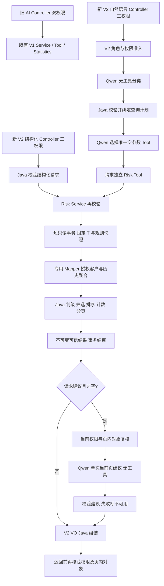

# CRM AI Agent V2-D1：后端架构与接口设计

- 日期：2026-10-18；状态：**技术设计建议，待人工架构评审，未实现、未验收**。
- 业务依据：[V2.0正式PRD](AI_AGENT_V2_REQUIREMENTS.md)、[R1可行性报告](AI_AGENT_V2_FEASIBILITY_REPORT.md)、[D1任务](../../task/1018/2-CRM-AI-Agent-V2-D1.md)。PRD的角色、三权限、状态、阈值、排序和20/50分页已冻结，本设计不重新裁决业务规则。
- 本阶段只新增本文档，不修改PRD、旧文档、源码、SQL、配置或数据库，不执行测试、构建或真实Qwen调用。所有新增类、路径、参数和限额均为待评审设计，不是当前可调用接口。

## 1. 设计目标与范围

在既有Java单体内增加安全只读的客户关注分析：后端固定时间与规则，按授权集合读取历史，Java判级、筛选、排序、计数后分页，Qwen仅生成当前页的辅助建议。覆盖关注清单、单客户原因、建议及全关注状态；排除历史回溯、计划逾期正式判定、预测概率、业务写入和完整跟进CRUD。

特别区分：`ALL_STATES`是适用客户的全部关注状态，绝非ALL组织范围，也不包含INACTIVE、公海或删除客户。不能把V1按created_at统计的时间窗口用于截断最后跟进历史。

## 2. 现有实现与复用边界

已定向核对项目上下文、V1需求/数据/版本记录、客户规则及后端规范，并读取以下生产代码、表结构和直接相关测试：

| 证据 | 当前事实 | V2决策 |
|---|---|---|
| [AiAnalysisController](../../backend/src/main/java/com/company/crm/controller/AiAnalysisController.java) | POST /api/ai/analysis，双权限，question≤1000，主体ID来自SecurityUser | 保持入口、授权和返回兼容；不加follow:list到V1 |
| [AiAnalysisService](../../backend/src/main/java/com/company/crm/service/AiAnalysisService.java) | 分类严格三字段；关闭内部工具执行；两阶段模型；手动最多一次Tool；Java生成answer | 复用执行模式，不把风险意图加入旧统计Tool或旧VO |
| [CustomerStatisticsTool](../../backend/src/main/java/com/company/crm/ai/tool/CustomerStatisticsTool.java)、[Factory](../../backend/src/main/java/com/company/crm/ai/tool/CustomerStatisticsToolFactory.java) | 请求独立、不可变绑定用户/请求范围；Schema仅timeRange；AtomicReference状态 | 复用隔离及次数限制方式；风险Tool另设，不修改旧Schema |
| [CustomerAnalysisScopePolicy](../../backend/src/main/java/com/company/crm/service/CustomerAnalysisScopePolicy.java) | 显式请求读有效角色；允许管理员ALL；CURRENT_AUTHORIZED跳过单角色限制 | 必须先加V2准入，不可直接作为完整门禁 |
| [DataScopeResolver](../../backend/src/main/java/com/company/crm/security/datascope/DataScopeResolver.java) | 按customer:list解析最大范围，ALL>DEPT>SELF，DEPT无部门拒绝 | 复用解析职责，不改V1规则 |
| [CustomerStatisticsService](../../backend/src/main/java/com/company/crm/service/CustomerStatisticsService.java)、[实现](../../backend/src/main/java/com/company/crm/service/impl/CustomerStatisticsServiceImpl.java) | 两参数兼容、三参数再校验范围；公共只读事务、Clock和聚合校验 | 风险另建Service；复用Clock、时间转换与防御思路，不依赖六个统计计数反推明细 |
| [CustomerMapper.xml](../../backend/src/main/resources/mapper/CustomerMapper.xml)、[CustomerMapper](../../backend/src/main/java/com/company/crm/mapper/CustomerMapper.java) | 列表/统计共享普通客户可见性，未排除INACTIVE | 复用共享过滤后再加V2状态条件；不改变原片段语义 |
| [Customer](../../backend/src/main/java/com/company/crm/entity/Customer.java)、[CustomerController](../../backend/src/main/java/com/company/crm/controller/CustomerController.java)及相关DTO/VO | 有建档/负责人，无分配历史；当前列表/创建，不是完整详情服务 | 新只读投影，不输出Entity或假定已有详情授权 |
| [SecurityConfig](../../backend/src/main/java/com/company/crm/config/SecurityConfig.java) | 已启用方法授权，非登录路由默认认证 | 新Controller加三权限；Service仍检查可信当前权限/角色 |
| [AiAnalysisVO](../../backend/src/main/java/com/company/crm/vo/AiAnalysisVO.java)、[Advice](../../backend/src/main/java/com/company/crm/exception/AiAnalysisExceptionHandler.java) | V1直接VO，ProblemDetail含code；Advice仅作用于旧Controller | 风险独立VO/模块Advice，沿用错误协议，不扩大旧Advice作用域 |
| [init.sql](../../database/init.sql) customer / follow_record | follow_at独立于created_at；target_type+target_id多态；无计划完成/分配事件 | 仅最小聚合读取，不新建完整FollowRecord业务模块 |

同时审阅AiAnalysisServiceTest、CustomerAnalysisScopePolicyTest、CustomerStatisticsToolTest及Customer Mapper/Service相关用例；现有测试不能代替新风险明细授权和规则测试。未发现关键PRD冲突。上下文中“V2尚未开发”仍符合当前代码状态，不表示R1尚未评审；本阶段不改上下文。

## 3. 总体架构与调用链

推荐两个独立V2读取入口，共用业务服务：一个自然语言编排入口，一个结构化交互入口。后者供分页、明确客户原因和“为当前页生成建议”操作，模型不可用时仍可读取确定性风险结果。



| 建议组件/位置 | 职责与依赖方向 |
|---|---|
| controller/AiRiskAnalysisController | 自然语言入口、请求校验、三权限、认证主体；只依赖编排服务 |
| controller/CustomerRiskController | 结构化只读操作入口，同样三权限；依赖业务/建议编排，不调用Mapper |
| service/AiRiskAnalysisService | 分类、计划绑定、唯一Tool协议、结果一致性及可选建议；不计算风险 |
| service/CustomerRiskAccessPolicy | 当前有效用户、单角色、三权限、最大/实际范围校验；复用现有角色权限Mapper和Resolver/范围策略 |
| service/CustomerRiskService及impl | 独立授权复核、短只读事务、固定T/规则、批量读取、规则计算/排序/计数/分页/对象原因 |
| service/CustomerRiskEvaluator | 无I/O纯Java规则函数与Comparator；不依赖Qwen、SecurityContext或Mapper |
| mapper/CustomerRiskMapper及XML | 只读授权集合与历史聚合；不继承BaseMapper，避免顺带暴露写方法 |
| service/RiskAdviceService | 事务外组织最小结构化输入、单次模型、输出验证和降级；不得重新定义等级 |
| ai/tool/CustomerRiskToolFactory、CustomerRiskTool | 请求不可变参数绑定、最多一次调用、调用Risk Service；不构造外部可传的SQL权限上下文 |
| config/风险规则属性、内部RuleSnapshot | 默认阈值/版本、合法性与不可变快照；不引入规则表/管理页面 |
| dto/risk、vo/risk、exception/风险Advice | 客户端请求/内部投影/可信结果/建议严格分离；直接VO、模块ProblemDetail |

以上名称用于后续任务定位，待评审后实施。依赖方向为Controller→编排/业务→策略、Evaluator、Mapper；Tool→业务，业务不回调Tool/模型；避免循环依赖及网络调用占用数据库事务。

## 4. 关键方案比较与推荐

| 决策 | 方案A | 方案B | 推荐及取舍 |
|---|---|---|---|
| AI入口 | 复用/api/ai/analysis，加版本分派；必须保留入口双权限，分类后V2分支另做三权限/角色校验，任何明细前完成 | 新V2入口，V1契约/权限不变；V2可在分类前做完整准入 | **B**：兼容与授权更容易验证，增加少量Controller但降低旧链路回归成本。A可行但响应联合类型、误路由及分支门禁复杂；绝不能把follow:list加在共享入口统一拦V1 |
| 数据访问 | 在CustomerMapper增加风险查询，复用现有位置 | 专用CustomerRiskMapper，只读投影，引用原共享过滤并加状态条件 | **B**：隔离复杂聚合及测试，不污染列表/统计；跨XML共享片段需显式namespace引用与加载测试，不复制不同口径 |
| 判级位置 | SQL CASE完成判级、排序、计数分页；适合大数据，但规则需与Java解释同步 | SQL只做历史聚合，Java唯一判级/Comparator，全集合计算后分页 | **B**：当前阶段可测试性、版本一致性更好，符合Java确定性要求；必须容量保护，不能无界内存。A留为规模演进，经等价性测试再采用 |
| Tool数量 | 一个通用只读Risk Tool，查询计划完全服务器绑定 | 分清单Tool与原因Tool，每次仅注册对应一个 | **A**：零模型参数，一个执行状态，模式在Java计划里分支；B语义直观但重复包装/状态，初版收益有限 |
| 建议返回 | 与风险同步完成，一次HTTP但等待模型 | 先返回风险，按需独立请求当前页建议 | **B为默认交互**：结构化LIST先展示，SUGGESTIONS再生成；同一自然语言请求明确索要建议时可同步返回已算风险及建议状态。两者均复用同一业务结果，模型失败不丢风险 |

不增加缓存集群、工作流引擎、RAG、多Agent、异步任务表或完整跟进CRUD。建议生成的分阶段返回不等于持久化快照，跨请求仍查询当前状态。

## 5. 角色权限与范围设计

### 5.1 三层强制检查

1. 两个新Controller均使用`ai:analysis AND customer:list AND follow:list`方法授权；现有JWT Filter恢复SecurityUser，客户端不提供操作者ID。V1 Controller保留原双权限。
2. `CustomerRiskAccessPolicy`从可信用户ID重新读取有效用户/有效角色及权限，确认启用未删除、**恰好一个**SALES_MANAGER或SALES_STAFF且三权限齐全；管理员/未知/多角色即使权限齐也403。不能仅用角色名或JWT自称范围。
3. 用现有DataScopeResolver解析customer:list最大范围，要求经理为DEPT、销售为SELF；DEPT必须有部门。准入通过后可复用CustomerAnalysisScopePolicy的销售范围决策；其前后的V2不变量校验必须保留，特别是CURRENT_AUTHORIZED仍先校验单角色/配置。无ALL执行分支。

V2策略输出内部不可变AccessContext：操作者、角色、authorizedScope、effectiveScope、当前部门和权限校验状态。调用方只能提交语义scopeIntent（默认CURRENT_AUTHORIZED或SELF/DEPT），不能直接传DataScopeContext。ALL语义422，非法枚举400；销售DEPT请求422；角色/最大授权不符和缺部门403。

自然语言入口在分类前完成准入，分类后校验请求范围并绑定计划；Tool调用业务服务时在新短事务重新查准入和范围。若与预期用户、角色、部门、最大/执行范围不一致，拒绝而不悄然切换到另一个范围。结构化入口也走相同服务校验，不能因为没有Tool就绕过。

### 5.2 Mapper与对象边界

- 所有风险集合：共享客户可见性条件，加`status IN ('POTENTIAL','ACTIVE')`。SELF比较`customer.owner_id=authenticatedUserId`，DEPT比较**客户当前负责人**的dept_id；不按跟进人/创建人过滤历史。
- 共享片段允许V1的ALL，因此风险Mapper外层必须再限定scopeCode仅SELF/DEPT，其他值AND 1=0，不能把共享片段本身当作V2准入；参数化绑定所有值，禁止`${}`拼接SQL。
- 单客户原因在同一个授权客户查询中增加`c.id=:customerId`，不先selectById再把全对象交给模型或Controller。不存在、范围外、INACTIVE、公海、删除客户统一404，不泄露存在性；全局准入先失败仍403。
- 旧会话、客户端ID、页码、指纹均不是授权证据；业务服务自己生成SQL范围，不暴露任意ownerId/deptId、SQL或排序表达式。
- 模型前与返回前在短事务中复核当前准入，以及最多50个结果客户仍属于当前有效集合；变化则403/409，不返回旧结果或悄然删行改变总数。复核为批量ID可见性读取，不重新逐客户统计。
- 授权检查与网络发送之间仍存在不可消除的时间窗口：不持有跨Qwen长事务，也不能撤回授权后曾发送的最小结构化数据。这里保证每个读取/发送边界重检，不承诺请求开始后的全程全局锁定；测试记录此并发边界。

## 6. 安全只读数据访问

### 6.1 最小查询与聚合

推荐专用Mapper返回每个授权客户一行`CustomerRiskAggregate`，只取id/编号/名称/等级/状态/owner必要状态/created_at、totalHistoryCount、validHistoryCount、invalidHistoryCount、lastValidFollowAt及异常分类计数，不取content、备注、联系方式、next_follow_at。

概念SQL流程（不是本阶段交付的SQL文件）：

```text
eligible_customers = 普通客户共享过滤 + POTENTIAL/ACTIVE + 可选等级集合
                     + 可选已校验单客户ID
LEFT JOIN follow_record
  ON target_type='CUSTOMER' AND target_id=eligible.id AND deleted=0
GROUP BY 每个客户必要字段
totalHistoryCount = COUNT(f.id)
validHistoryCount = SUM(f.id非空 AND follow_at非空
                        AND created_at <= follow_at AND follow_at <= T)
lastValidFollowAt = MAX(CASE有效业务时间 THEN follow_at END)
invalidHistoryCount = totalHistoryCount - validHistoryCount
```

LEFT JOIN条件不能移到外层WHERE导致无跟进客户消失；空JOIN行不得算作一条异常记录。不能先按当前页客户取跟进再对全范围声称已排序/计数，也不能直接按follow_record.owner_id限制SELF。孤立/非CUSTOMER记录不进入授权客户JOIN，不能在请求中另查全库孤立明细。

列表一次批量聚合完成，原因查询同样方法但限定一个客户；不新增FollowRecord CRUD或把完整实体列表加载到Java。已有`idx_follow_record_target(target_type,target_id,follow_at)`可评估利用，是否增含deleted的索引留EXPLAIN/规模验证，本阶段不DDL。

### 6.2 时间与数据质量分流

- total=0：NEVER_FOLLOWED，建档年龄判定；历史逻辑删除不计入total。
- valid>0：FOLLOWED，按MAX有效follow_at判级；invalid>0则同时HAS_ANOMALIES，不丢有效结果。
- total>0且valid=0：INVALID_ONLY、DATA_REVIEW，riskLevel=null；不得套建档7/14天判高。
- 未来、NULL或早于建档的follow_at计异常且不参与MAX。时间全部解释为Asia/Shanghai业务DATETIME，绑定由同一个Clock生成的T；不按record.created_at或customer.updated_at替代。
- 客户建档未来/缺失、非法非空等级、失效负责人等阻止可靠判级时，保留授权边界内的数据质量标记，不默认为未评级或低关注；DATA_REVIEW在ALL_STATES可见，默认不混入。用户自身身份/部门配置失败属于拒绝，不是可绕过的质量状态。
- contact_id可空、历史跟进人与当前负责人不同不是时间风险异常；计划字段不读，不把计划缺失/过期计成风险。同follow_at无需窗口函数即可MAX；若后续需要最新记录内容才使用`ROW_NUMBER(...follow_at DESC,id DESC)`，不作为本版必需成本。

### 6.3 聚合、批量与容量取舍

SQL GROUP BY比先读取所有跟进原文再Java聚合更省数据且降低泄露面；窗口函数适合取整条最新记录，但本版只需要MAX/COUNT，建议不引入；按客户逐一查询不可接受。

SQL只聚合、Java判级意味着必须读齐本次授权筛选后的客户聚合集合。设置后端`maxCandidates`容量保护（评审起点5000，待S1测量，不是业务分页上限）：授权候选CTE最多读取cap+1行并聚合；一旦超过cap，**整次查询受控拒绝**，不对截断集合返回匹配总数/风险页。不能LIMIT 20后再判级。页大小50不能代替总集合保护。独立单客户原因查询不扫描全范围。

单次SQL超时、输出行数/内存预算均受限；历史扫描仍可能很大，必须独立测量和超时控制，不能用随意截断历史改变最近跟进口径。后续扩展SQL判级时需保持Java参考实现的等价性，不能为性能修改业务阈值。

## 7. 风险计算与规则配置

### 7.1 内部输入/输出

| 数据结构（建议） | 内容与可信来源 |
|---|---|
| RiskQueryPlan | action、scopeIntent、queryMode、等级筛选、客户ID、page/size；Java验证后的不可变计划，不接受用户的T、等级或SQL上下文 |
| RiskExecutionContext | authenticatedUserId、复核后的AccessContext、后端T、RuleSnapshot；不暴露为可绑定HTTP DTO |
| CustomerRiskAggregate | Mapper最小投影，计数及有效时间必须一致，异常聚合拒绝假零 |
| RiskAssessment | 客户最小信息、state、riskLevel、historyStatus、lastValidFollowAt、anchorType、elapsedDays、thresholdDays、excessDays、reasons、dataQuality |
| RiskPageResult | 不可变排序后当前页、total、page/size/returned/pages、规范查询及执行上下文；不包含模型文本 |

业务公共方法建议为`analyze(trustedUserId, validatedPlan)`；T/规则从内部可信Context Factory获取，不允许HTTP/模型注入历史时间。Evaluator仅接收单客户聚合、T、RuleSnapshot，便于边界测试。两层Java输入不是“调用方构造即可信”：业务入口重新解析范围，核对与编排预期一致。

### 7.2 确定性规则与排序

完整规则以PRD第5节为准：有效历史A级14/30，B/C/D/未评级30/60；无历史建档不足7天观察、7天中、14天高。`elapsedDays=floor(Duration(anchor,T)/24h)`，达到即命中。未来锚点走质量状态，不取绝对值或max(0)掩盖异常。

正常state=NORMAL，riskLevel=HIGH/MEDIUM/LOW；特殊state=OBSERVING或DATA_REVIEW且riskLevel=null。FOLLOWED锚点LAST_VALID_FOLLOW；NEVER_FOLLOWED锚点CUSTOMER_CREATED但lastValidFollowAt=null；INVALID_ONLY锚点NONE，间隔/阈值/超期均null。

超期指**超过当前关注等级起点**的完整天数，不是计划逾期。有效历史HIGH/MEDIUM起点取其组阈值，LOW起点0；无历史HIGH/MEDIUM起点14/7；特殊状态无excessDays。正常排序键为(HIGH/MEDIUM/LOW序、A/B/C/D/null序、excessDays降序、BIGINT id数值升序)，不按字符串ID字典序。ALL_STATES先正常排序结果，再OBSERVING，再DATA_REVIEW；两类特殊分区内按客户等级和ID升序，不赋予风险高低。PRIORITY只保留HIGH/MEDIUM。

客户去重后只记一次，风险最高规则获胜，不同真实原因保留；同一时间间隔事实仅一个规范原因，不把“长期未跟进”与“等级滞后”复制为两个独立风险。原因建议编码FOLLOW_GAP、NEVER_FOLLOWED，证据带阈值组/锚点/观测/当前等级起点；低关注与特殊状态用assessmentSummary解释，不伪造风险命中。

### 7.3 后端配置与追溯

建议`@ConfigurationProperties`前缀`crm.ai.risk.rules`，配置声明版本、a.mediumDays=14/a.highDays=30、others.mediumDays=30/others.highDays=60、never.observationDays=7/never.highDays=14。值为正整数、组内起点严格递增，所有组齐全、无未知组，声明版本非空；不允许模型覆盖。

生成不可变RuleSnapshot；有效`ruleVersion=声明版本+规范配置SHA-256`，另保留configHash和规范化参数以便追溯。散列覆盖规则语义版本及会影响判定/排序的参数；同一声明标签下阈值变化也形成不同有效版本，不能沿用旧完整版本。发布记录归档无敏感信息的配置快照，本版只支持启动加载/重启生效，不设计热更新或规则表。

请求开始取得同一个RuleSnapshot引用，判级、原因、超期、排序、计数及建议全部使用它；不在循环读取可变属性。配置非法则风险模块NOT_READY并返回503，不静默混默认值；采用模块就绪校验，不因新增风险配置错误改变V1判定逻辑。模块隔离的启动行为需S1验证，不能假定全局Bean校验失败仍可服务。

## 8. API与DTO/VO契约

### 8.1 推荐入口

| 方法/路径（新设计） | 用途 | 模型调用 | 权限 |
|---|---|---|---|
| POST /api/ai/risk-analysis | 自然语言清单、选中客户原因、明确索要建议 | 分类1次、Tool选择1次；建议可再1次 | 三权限+V2角色/范围 |
| POST /api/customer-risks/analyses | 结构化LIST、REASON、SUGGESTIONS；分页及当前页建议 | LIST/REASON为0；SUGGESTIONS至多1次 | 完全相同三权限+V2角色/范围 |
| POST /api/ai/analysis（既有） | V1总量/等级分布 | 原有流程不变 | 原双权限及V1.1范围，不增加follow:list |

新Controller内部路径省略/api前缀。两个新POST均为只读分析，不创建持久化analysis资源；无需独立的FollowRecord详情API、导出或批量任意ID接口。V1成功仍为AiAnalysisVO，不能把它改成风险联合响应或统一data包装。

### 8.2 客户端输入

| DTO（建议） | 白名单字段 | 规则 |
|---|---|---|
| AiRiskAnalysisRequest | question、page、size、customerId | question非空白≤1000；page默认1，size默认20且≤50；customerId仅单客户原因且由用户选中明确提供 |
| CustomerRiskRequest | action、scopeIntent、queryMode、customerLevels、page、size、customerId、expectedResultFingerprint | action=LIST/REASON/SUGGESTIONS；scope默认CURRENT_AUTHORIZED，仅SELF/DEPT显式；queryMode默认PRIORITY或ALL_STATES；等级集合只含A/B/C/D/UNRATED，空数组非法，null或省略表示不限等级 |

操作条件：LIST/SUGGESTIONS禁止customerId；REASON必须customerId且不接受queryMode/customerLevels/page/size/指纹，不因默认PRIORITY而屏蔽低关注或特殊状态原因。SUGGESTIONS指定规范清单条件重新计算当前页，不能上传上一页的客户数组、等级、原因或模型事实。expectedResultFingerprint仅允许SUGGESTIONS，可用于旧页提示；默认空，不作为权限凭据。

先按操作检查显式字段，再只给LIST/SUGGESTIONS应用分页/模式默认值；自然语言请求在分类完成后做同样检查，不把自动补出的1/20误当REASON非法输入，也不静默忽略客户端真传的额外条件。指纹为非空、至多128字符的比较值（可省略），服务器输出规范摘要；不把用户提交的任意字符串解析为快照或授权。

所有ID为正十进制**字符串**，转换时校验≤Long.MAX_VALUE，拒绝JSON数字、科学计数、溢出及前导零；page/size必须整数且page≥1，计算偏移用long并检查溢出，不接受客户端排序表达式。V2局部严格解析未知字段/重复键/错误类型，不全局改变旧DTO的解析行为。userId、role、deptId、effectiveScope、T、ruleVersion、SQL等字段一律禁止。

自然语言REASON只使用HTTP选中ID，不从模型生成客户ID、名字或“上一个客户”查找。缺选中对象返回422要求选择；显式文本与选择对象冲突/目标不明确时拒绝澄清，不能让模型猜另一个客户。自然语言分页由HTTP参数控制，不从文本提取任意offset；后续翻页用结构化入口和返回的normalizedQuery。

### 8.3 服务器输出

新入口均直接返回RiskAnalysisVO，不增加V1包装。V2 DTO/VO局部采用明确的null字段序列化约定，必填可空字段也输出null；不得依赖当前全局NON_NULL造成前端必填字段缺失，不修改全局配置。

| 结构 | 字段及约束 |
|---|---|
| RiskAnalysisVO | status=SUCCESS/PARTIAL、intent=RISK_LIST/RISK_REASON/RISK_SUGGESTIONS、answer（Java生成）、analysisContext、normalizedQuery、page、records、resultFingerprint、advice |
| analysisContext | authorizedScope、effectiveScope、requestedScope、analysisTime（+08:00 ISO）、timezone=Asia/Shanghai、ruleVersion、consistency=LIVE_REQUEST_SNAPSHOT；不返回操作者/部门ID |
| normalizedQuery | LIST/SUGGESTIONS为scopeIntent/queryMode/customerLevels/page/size；REASON为scopeIntent/customerId；由Java归一化，可作为下次请求语义，不是可信执行上下文 |
| page | number、size、returned、total、pages；total为本次筛选去重后的匹配客户数，returned为当前页数；REASON时page=null |
| records[] | customerId、customerNo、customerName、customerLevel（A/B/C/D/null）、customerStatus、state、riskLevel、historyStatus、lastValidFollowAt、anchorType、elapsedDays、thresholdDays、excessDays、reasons、dataQuality |
| reasons[] | code、message（Java）、evidence{anchorTime,elapsedDays,thresholdDays,levelGroup}；levelGroup=A/OTHER/NEVER，不能冒充另一个独立风险 |
| dataQuality | status=CLEAN/HAS_ANOMALIES、codes[]；不含原始跟进正文或跨客户ID |
| advice | status=NOT_REQUESTED/AVAILABLE/UNAVAILABLE/NOT_APPLICABLE、source=null/QWEN_STRUCTURED、unavailableCode（可空）、message（可空）、items[]；items为customerId/actions，actions为受控code和Java渲染text |

state=NORMAL才有riskLevel；OBSERVING/DATA_REVIEW为特殊状态，不把它们编码进riskLevel。全局status=PARTIAL仅表示可信分析成功、已请求的建议失败；未请求建议为SUCCESS/NOT_REQUESTED，空清单请求建议为SUCCESS/NOT_APPLICABLE。无匹配时records=[]、total=0、returned=0、pages=0；页码超出末页也返回空records但保留真实total，不伪装匹配总数为0。REASON成功仅一条，未找到则404而不是空清单。

### 8.4 请求示例

自然语言：

```json
{"question":"我个人有哪些客户需要优先跟进？","page":1,"size":20}
```

明确全关注状态的结构化分页：

```json
{"action":"LIST","scopeIntent":"SELF","queryMode":"ALL_STATES","page":1,"size":20}
```

选中客户的原因，不用模型提取ID：

```json
{"action":"REASON","scopeIntent":"SELF","customerId":"2300000000000000001"}
```

为当前页请求建议：

```json
{"action":"SUGGESTIONS","scopeIntent":"SELF","queryMode":"PRIORITY","page":1,"size":20,"expectedResultFingerprint":"此前服务器返回的指纹"}
```

### 8.5 成功与部分成功示例

下例为**虚构的单客户契约示例，不是R1数据库重算或验收结果**；有效规则版本的64个0是摘要占位。T为10月18日20:30，最后跟进9月16日20:30，完整32天，A级HIGH起点30天，excessDays=2。

```json
{
  "status": "SUCCESS",
  "intent": "RISK_LIST",
  "answer": "本人范围内匹配到1个高/中关注客户，本页返回1个。",
  "analysisContext": {
    "authorizedScope": "DEPT",
    "effectiveScope": "SELF",
    "requestedScope": "SELF",
    "analysisTime": "2026-10-18T20:30:00+08:00",
    "timezone": "Asia/Shanghai",
    "ruleVersion": "V2.0-1+0000000000000000000000000000000000000000000000000000000000000000",
    "consistency": "LIVE_REQUEST_SNAPSHOT"
  },
  "normalizedQuery": {"scopeIntent":"SELF","queryMode":"PRIORITY","customerLevels":null,"page":1,"size":20},
  "page": {"number":1,"size":20,"returned":1,"total":1,"pages":1},
  "records": [{
    "customerId": "2300000000000000001",
    "customerNo": "EXAMPLE-001",
    "customerName": "示例客户甲",
    "customerLevel": "A",
    "customerStatus": "ACTIVE",
    "state": "NORMAL",
    "riskLevel": "HIGH",
    "historyStatus": "FOLLOWED",
    "lastValidFollowAt": "2026-09-16T20:30:00+08:00",
    "anchorType": "LAST_VALID_FOLLOW",
    "elapsedDays": 32,
    "thresholdDays": 30,
    "excessDays": 2,
    "reasons": [{
      "code": "FOLLOW_GAP",
      "message": "A级客户距最近有效跟进32天，已达到高关注30天阈值。",
      "evidence": {"anchorTime":"2026-09-16T20:30:00+08:00","elapsedDays":32,"thresholdDays":30,"levelGroup":"A"}
    }],
    "dataQuality": {"status":"CLEAN","codes":[]}
  }],
  "resultFingerprint": "服务器生成的当前页条件与可信结果摘要",
  "advice": {"status":"NOT_REQUESTED","source":null,"unavailableCode":null,"message":null,"items":[]}
}
```

正常未跟进客户的lastValidFollowAt必须为null，anchorType=CUSTOMER_CREATED；观察中riskLevel/thresholdDays/excessDays为null但elapsedDays是建档年龄。INVALID_ONLY则state=DATA_REVIEW、riskLevel=null、anchorType=NONE、elapsedDays/thresholdDays/excessDays=null，不能写成“高风险无限天”。reasons为空，数据异常通过dataQuality及Java answer表达，不伪造风险原因。

已请求建议但失败时保留上述records/page/context，intent改为RISK_SUGGESTIONS，根status改为PARTIAL，仅建议片段替换为：

```json
{"status":"UNAVAILABLE","source":null,"unavailableCode":"RISK_ADVICE_UNAVAILABLE","message":"建议暂不可用，已保留关注分析结果。","items":[]}
```

正常AVAILABLE片段示例（同一受控页面映射，不含模型自造ID）：

```json
{"status":"AVAILABLE","source":"QWEN_STRUCTURED","unavailableCode":null,"message":null,"items":[{"customerId":"2300000000000000001","actions":[{"code":"VERIFY_CURRENT_NEEDS","text":"先确认客户当前需求及是否有变化。"}]}]}
```

## 9. Spring AI Tool设计

推荐唯一`getCustomerRiskAnalysis`，建议方法无参数，模型可见Schema为`{"type":"object","properties":{},"additionalProperties":false}`，只接受空对象。action、查询模式、客户ID、范围、分页、预期AccessContext由Factory绑定的不可变计划决定；T和RuleSnapshot在Risk Service创建内部执行上下文时一次性取得，均不由模型填写。需要显式参数的备选方案也只能让模型回显已验证模式并要求完全相等，没有额外授权价值，故不推荐。

Factory每请求创建实例，绑定真实用户ID、ValidatedPlan及预期范围。用户/分页/ID等先按第8节验证；S1业务服务再验证，不把Factory当唯一安全边界。Tool自身使用NOT_EXECUTED→RUNNING→SUCCEEDED/FAILED状态，失败也不得再次调用。业务入口获取可信执行上下文，不能接受未核验的外部权限对象；同一个请求最多一个业务Tool、一次风险聚合，权限/对象复核的批量读取不计为第二次风险统计。

Java检查单一function调用、精确工具名、arguments严格空对象且无重复键/尾随内容。模型伪造customerId、userId、deptId、role、scope、page、SQL等均在执行业务前拒绝；未知工具或未调用502，重复调用409，非法参数400。手动执行后校验实际范围、模式、客户ID/分页与绑定计划一致，所有记录/原因和建议使用业务执行上下文的同一T与规则版本，不能返回不同范围的成功结果。

Tool返回RiskPageResult给Java编排；关闭`internalToolExecutionEnabled`，不把完整Tool结果再次交给模型自由解释。建议阶段只发送新的最小投影。结构化接口直接调用同一Risk Service而不伪造一次模型/Tool请求；其安全验证与自然语言入口等价。

## 10. Qwen意图路由与建议编排

### 10.1 V1/V2的明确分流

| 语义 | 入口及行为 |
|---|---|
| 客户总量CUSTOMER_TOTAL | 原/api/ai/analysis，旧双权限和统计Tool，不要求follow:list |
| 等级分布CUSTOMER_GRADE_DISTRIBUTION | 同上，原VO不变 |
| 风险清单/单客户原因/建议 | 新V2入口先准入，再分类和风险Tool |
| V2入口收到V1统计问题 | 422 RISK_USE_STATISTICS_ENDPOINT，提示使用统计入口；不悄然调用旧Tool |
| V1入口收到风险问题 | 按旧支持边界拒绝；不注册风险Tool或提前查明细。是否在未来统一入口属于另一次兼容性变更 |
| 历史回溯、计划逾期、写入、指定其他人/部门、模糊对象 | 受控422/澄清，不查业务明细 |

推荐交互层明确选择统计/关注分析入口，后续S3处理，不凭角色隐藏替代后端权限。模型家族标签本身绝不是授权：即便误分类，V1只能返回授权统计，V2每个读取仍必须通过准入。语义误路由属于正确性问题，需测试，不能因“未越权”就算成功。

V2分类无业务工具，严格输出六字段：`intent`、`scopeIntent`、`queryMode`、`customerLevels`、`timeIntent`、`targetMode`。intent白名单为三个RISK意图、两个V1统计意图及UNSUPPORTED；scope使用已有请求范围语义；queryMode=PRIORITY/ALL_STATES；等级为白名单数组或null；timeIntent=CURRENT_SNAPSHOT/HISTORICAL/UNSUPPORTED；targetMode=NONE/SELECTED。不能输出userId、customerId、实际dataScope或自然语言统计数字。除customerLevels外其余字段为枚举字符串；严格拒绝额外字段、非法值、重复键及尾随JSON。

Java将结果转换为ValidatedPlan：仅明确请求全状态才允许ALL_STATES；历史/自定义时间与不支持语义422，原因要求HTTP选中ID及targetMode=SELECTED，其余模式不得带ID。具体语言歧义不能靠客户端声称已校验绕过，应澄清/拒绝；分类仍有抽样准确性限制，不能宣称所有同义表达确定正确。

V2自然语言成功最多分类1次、工具选择1次、建议1次；没有模型循环、工具重试或逐客户模型请求。单客户原因的解释由Java证据生成，非必须再调用模型。分类/工具阶段失败尚无可信结果时返回相应4xx/502/503；不要误标成已有结果的部分成功。

### 10.2 建议的事实保护与降级

不推荐直接让模型返回包含等级、日期、ID与长自由文本的完整风险VO，再试图用字符串检查证明没有幻觉。推荐首版使用**结构化建议动作选择+Java受控模板渲染**：Qwen负责基于可信指标组织建议，Java负责事实和最终响应。

输入仅当前页必要记录的局部别名r1…r50、关注状态、等级组、间隔/阈值及可信原因键；不发送真实客户ID、名称、联系方式、正文、地址、备注全文或完整历史。输出白名单为alias、actions[]、reasonKeys[]；actions取受控建议类型，例如VERIFY_CURRENT_NEEDS、CONFIRM_CONTACT_PREFERENCE、DISCUSS_NEXT_STEP、VERIFY_DATA。每客户最多3项，所有引用必须来自该页，reasonKeys必须是该客户已有键；DATA_REVIEW仅允许VERIFY_DATA，不伪造风险等级；观察中不能输出紧急逾期理由。

严格检查输出JSON、别名唯一性、动作/原因白名单、每项数量与整体覆盖；任一非法或缺失导致本次页建议整体UNAVAILABLE，保留风险结果。Java按原页顺序映射真实ID并渲染只描述待核实动作的文案；不接受模型提供的数字、日期、等级、排序、客户事实或原始自由文本。因此防止的是模型修改可信结果，并通过受控模板减少虚构业务事实，不宣称任意自然语言可被完美事实校验。

建议客户端缺失、超时、模型错误、协议异常、超输入预算均返回分析HTTP 200/PARTIAL+advice.UNAVAILABLE；空页无需模型，NOT_APPLICABLE。模型前/后权限失败不是可降级的模型错误，必须终止整个响应而非带旧客户返回。受控动作方案与需要多少模板/是否后续开放自由文案属于架构评审点，不改变“模型负责辅助建议、Java负责风险”的业务分工。

## 11. 分页、性能、一致性与异常

### 11.1 事务与分页一致性

风险读取公共方法使用短`@Transactional(readOnly=true, isolation=REPEATABLE_READ)`，在同一请求数据快照中完成准入/范围复核、一次授权聚合、Java判级/筛选/排序/计数，再按(page−1)×size取页。T在该次业务执行开始由Clock固定，不在每条记录上调用now；T是计算参考时间，不声称等于MySQL MVCC事务ID。

模型调用在事务外。结构化LIST/REASON不依赖模型是否启用；自然语言分类不可用时503，已经有风险结果的建议客户端不可用则部分成功。不得把网络等待放在只读事务里长期占连接。

跨HTTP请求是重新分析当前状态，不复用客户端上传的T或旧规则。Offset在数据变更时可能重复/漏过此前页的条目；返回`consistency=LIVE_REQUEST_SNAPSHOT`及本次T，明确不保证跨页历史快照。首版不引入持久化快照表、缓存会话或历史风险回放。后续若要求严格跨页一致，需要另行设计，不能声称仅凭稳定ORDER BY已经解决变更一致性。

为“当前页建议”提供`resultFingerprint`：服务器对规范查询、操作者/范围归属、完整规则版本、已排序当前页可信记录及匹配总数做规范摘要，**不包含T本身**（T每次变化），也不把摘要当授权令牌。SUGGESTIONS重新取当前T并计算；若提交的expectedResultFingerprint不符，409要求刷新，不发送过期页给模型。若一致则对新快照结果生成建议并返回新T，页面应更新上下文。记录/分级/页序因时间跨阈值或数据变化会改变指纹。该机制检测可见结果变化，不提供旧数据读取，也不能代替三权限与对象校验。

### 11.2 资源控制建议（待测量）

| 资源 | 设计建议 | 失败行为 |
|---|---|---|
| page/size | 默认1/20，size≤50；无动态sort、任意ID数组 | 非整数/越界400，不能静默裁成合法值 |
| 授权客户聚合 | maxCandidates建议5000，cap+1检测，历史不截断；单原因只查目标客户 | 超容量503 RISK_CAPACITY_EXCEEDED，禁止返回不完整总量 |
| SQL | 参数化、一次聚合、固定数量权限/批量对象复核；建议查询超时5秒起点评估 | 受控查询错误，不用空页或0替代 |
| 建议模型 | 一页最多50别名，单次输入建议≤12k token、输出≤4k token，至多3个动作/客户；不隐式截断页或分成无界调用 | 超输入限额/输出截断均建议UNAVAILABLE，保留风险；不自动重试 |
| 模型阶段 | 自然语言最多3次，结构化建议最多1次；连接5秒、单次读取20秒为评估起点 | 不发无限后续调用；建议阶段超时降级，分类/Tool阶段503 |
| 总请求与并发 | 新V2独立超时预算，建议服务端85秒/前端95秒起点评估；对用户/全局模型并发设有界限额 | 429繁忙或阶段受控超时；已有核心结果的建议限流转UNAVAILABLE |

以上5000、SQL/模型预算和超时是**工程评审起点，非实测性能结果或已冻结业务阈值**；S1/S2需用代表性规模定额，保持PRD的20/50和先算后分页不变。前端V2超时不得改旧V1 60秒配置；服务端传递剩余截止时间，不只让浏览器断开而后台无限等待。客户端取消与连接超时的实际中断能力需单独测试，不承诺仅靠线程中断一定停止阻塞调用。

### 11.3 ProblemDetail与部分成功

新模块Advice仅绑定两个新Controller，复用安全入口401/403与RFC 7807形式，不改变旧Advice。建议映射：

| HTTP | code | 情况与结果 |
|---|---|---|
| 400 | RISK_REQUEST_INVALID | 请求格式、未知字段、分页、ID、枚举非法；无业务结果 |
| 401 | UNAUTHORIZED / RISK_AUTHENTICATION_REQUIRED | 未认证/可信主体缺失 |
| 403 | RISK_ACCESS_DENIED | 三权限、角色、用户状态或角色范围配置不符 |
| 403 | DATA_SCOPE_CONFIGURATION_ERROR | 复用Resolver的无授权/缺部门异常 |
| 403 | RISK_ACCESS_CONTEXT_CHANGED | Tool前或模型前后权限、角色、部门/范围改变 |
| 404 | RISK_CUSTOMER_NOT_FOUND | 单客户不存在/不可见/不适用，统一说明 |
| 409 | RISK_RESULT_STALE | 当前页条件指纹不符，或页内对象在执行期间改变；无旧页返回 |
| 409 | RISK_TOOL_REPEATED | 多Tool或重复执行，不能二次读取 |
| 422 | RISK_SCOPE_UNSUPPORTED | ALL、销售DEPT等语义范围不合法 |
| 422 | RISK_QUERY_UNSUPPORTED / RISK_CUSTOMER_SELECTION_REQUIRED | 历史/计划/写操作等不支持、对象需选择或歧义需澄清 |
| 422 | RISK_USE_STATISTICS_ENDPOINT | 风险入口收到V1统计需求，返回使用旧入口的安全说明 |
| 400 | RISK_TOOL_ARGUMENT_INVALID | 非空或非法Tool arguments，业务前拒绝 |
| 502 | RISK_MODEL_RESPONSE_INVALID | 分类/Tool协议失败或可信结果上下文不一致，未生成可返回核心结果 |
| 503 | RISK_MODEL_UNAVAILABLE / RISK_AI_NOT_READY | 分类/Tool阶段模型失败或未启用 |
| 503 | RISK_RULES_NOT_READY / RISK_CAPACITY_EXCEEDED | 规则配置不可用或集合容量超过保护值 |
| 429 | RISK_TOO_MANY_REQUESTS | 尚未执行核心查询前资源准入限流 |
| 500 | RISK_QUERY_FAILED / RISK_ANALYSIS_FAILED | 数据查询/聚合不一致/其他安全封装异常，不外露SQL |
| 200 | status=PARTIAL、advice.UNAVAILABLE | 核心成功、建议失败/限流/预算不足；保留真实records/total，不返回ProblemDetail代替整个结果 |

建议失败的unavailableCode取RISK_ADVICE_UNAVAILABLE、RISK_ADVICE_INPUT_LIMIT或RISK_ADVICE_NOT_READY等受控值，不返回模型原文错误。空结果不是异常，不使用206分段内容或把模型失败报为“没有关注客户”。

## 12. 安全边界与失效处理清单

1. V2三权限和单有效销售角色在任何风险明细查询前完成；只查权限元数据不算提前读取客户。直接调Service同样受保护。
2. 不接受模型/HTTP提供身份、部门、实际范围、分析时间、阈值、已计算等级；语义scope仍需后端校验。
3. SQL始终限定授权客户、POTENTIAL/ACTIVE、非删除/非公海；跟进关联带CUSTOMER和deleted=0，不按跟进人改变客户边界。非法ALL上下文在Mapper亦fail-closed。
4. 默认查询只含高/中，全状态不扩大生命周期或组织范围；特殊状态不伪装风险等级，默认空页不能称全体客户无风险。
5. 单客户、页内建议、前次结果ID都重新授权；请求指纹、模型alias、旧临时会话都不是可转授的能力。
6. 可信风险结果不可变，模型无机会覆盖等级/数字/日期/原因/排序；建议只附加经校验动作，不能写库或执行SQL。
7. 最小化模型及日志输入：不记录JWT、Key、密码、正文、完整请求或完整客户清单；只记录请求关联标识、动作、受控失败类型、数量、规则版本及耗时。新增请求关联标识属于后续实现设计，不冒充现有V1能力。
8. 业务异常与模型建议异常分开；权限撤销必须整体停止，不以PARTIAL夹带旧客户；无Qwen时结构化风险读取仍可用。
9. 不自动使用历史ALL管理员资格，不改变V1功能权限、SQL口径、现有统计Tool schema或response；回归中必须包含仅双权限无follow:list的V1成功路径。

## 13. 测试与验收设计

以下均为后续计划，本次未执行或宣称通过V2测试。

| 层级/场景 | 必测点 | 阶段与方法 |
|---|---|---|
| Evaluator边界 | A 14/30、其他30/60、无历史7/14分别在前1毫秒/恰好/后1毫秒；跨自然日未满24小时不提前命中 | S1固定Clock纯单元 |
| 数据状态 | 无记录、只有删除记录、只有未来/早于建档异常、有效+异常、NULL时间防御；未评级不套A级 | S1单元+聚合投影测试 |
| 排序与去重 | HIGH/MEDIUM/LOW→A/B/C/D/null→excess降序→数值ID升序；同事实原因去重、取最高；特殊分区独立 | S1单元，含不同长度数字ID与阈值超期0 |
| 规则配置 | 组缺失、负数/相等阈值、版本空、hash变化、请求中快照不变；风险未就绪不污染V1 | S1配置/上下文测试 |
| SQL与集合 | LEFT JOIN零记录、空行不算异常、MAX仅有效时间、不按follow owner、同ID异type、逻辑删除、公海/INACTIVE排除 | S1 Mapper结构+受控MySQL集成；H2不冒充MySQL |
| 范围和单对象 | 经理DEPT/SELF差异、销售SELF、客户端越界ID、不可见与不存在同404，聚合前已限定范围 | S1服务/Mapper，S2-A HTTP |
| 角色/功能权限 | 三权限分别缺失、两管理员、多角色含管理员/销售、未知角色、配置不符；默认也拒绝 | S1策略单元，S2-A MockMvc |
| 分页与容量 | default20/max50，先全局判级排序计数再取页；空页保留total、cap+1整次拒绝，无假总数 | S1单元/规模用例，S2-A协议 |
| Controller/VO | 严格类型/未知字段/超大ID、必填可空JSON、所有错误映射、默认与全状态分离 | S2-A MockMvc与合同测试 |
| Tool隔离 | Schema空参数；伪造userId/customerId/page/scope、错误名、多调用、失败重试、并发不同用户模式均安全 | S2-B Mock模型+真实Tool对象 |
| 意图路由 | V1两统计、新三风险意图、历史/计划/混合写入/ALL_STATES歧义、SELECTED缺ID；V1不要求follow:list | S2-B Mock，大量边界不付费 |
| 建议失败/污染 | 不认识alias、额外ID/等级、缺项、伪造reason、超动作数、超token、超时、未启用及限流均保留风险并标不可用 | S2-B Mock，不能只测模型正常文本 |
| 并发与一致性 | 两阶段授权/部门/owner变化、单次同T同规则、指纹不符409、跨页变更LIVE语义，取消不无限后台运行 | S2-A/B受控集成 |
| 旧版本回归 | AiAnalysisService/Tool/Controller、CustomerStatisticsService、ScopePolicy、DataScopeResolver旧测试，管理员ALL及多角色默认原语义 | 各阶段运行直接受影响用例，不删旧断言 |
| 真实SQL与模型 | 在正式状态过滤/阈值下重新独立对账；模型只少量代表性清单/原因/建议/拒绝请求 | S4显式授权环境，记录真实与Mock差异 |
| 前后端E2E | 经理DEPT/SELF、全状态特殊状态、三权限/管理员拒绝、页大小/总数、建议失败仍显示Java结果、指纹变化刷新 | S3前端接入后，S4浏览器验收 |

S4需准备授权测试环境的异常/交接/排序样本；本次不插入或修复数据，也不复用R1含INACTIVE的290总量当冻结规则答案。真实登录会更新审计字段，后续验收须核对授权和副作用；D1不登录、不访问数据库、不跑真实Qwen。

## 14. 后续实施拆解与退出条件

| 阶段 | 实施范围 | 退出条件与禁止提前扩展 |
|---|---|---|
| V2-S1 | 安全准入/范围策略、规则快照/配置、只读聚合Mapper、纯Evaluator/Comparator、风险Service及内部结果；最小对象读取 | 无模型和新HTTP入口也能独立正确判级、过滤、分页；三权限及对象边界单测/SQL验证；不开发完整Follow CRUD |
| V2-S2-A | 独立Controller、严格DTO/VO、模块Advice、结构化LIST/REASON及HTTP合同，建议状态契约 | MockMvc覆盖三权限/角色/404/分页及V1兼容；未接建议时明确NOT_READY/UNAVAILABLE，不假称建议可用；不改旧入口授权 |
| V2-S2-B | 自然语言分类、空参数Tool/Factory、绑定计划及结果检查、当前页Qwen动作建议/降级、模型预算 | Mock覆盖注入/隔离/误路由/建议失败；最多一次Tool，不无界模型调用；不默认为真实联调通过 |
| V2-S3（后续） | 前端选择统计/关注入口、查询/分页/原因/建议及特殊状态展示 | 不用前端控件代替后端授权，不把全状态解释为ALL或INACTIVE |
| V2-S4（后续） | 授权环境真实MySQL/Qwen/浏览器与性能验收 | 独立SQL、边界数据、模型/界面证据、容量/超时达标后才称V2验收 |

S1/S2-A不能把后续模型未接入包装成全功能完成；结构化SUGGESTIONS若在S2-A暴露，仍须先计算可信结果后返回advice.UNAVAILABLE/RISK_ADVICE_NOT_READY，而非200假建议或丢弃核心结果。每阶段遵循最小回归，出现必须修改冻结业务规则时停止对应实现并报告。

## 15. 架构评审事项与结论

未发现需暂停整体设计的关键PRD矛盾。以下是技术评审点，不重新询问已冻结的角色、阈值、INACTIVE排除、排序优先级或分页默认值：

1. 是否采纳独立V2自然语言+结构化两个入口，以及与旧统计界面的明确分流；若选共享入口，必须接受分支授权与联合契约改造成本。
2. 是否接受专用只读Mapper、共享过滤外加V2限制、SQL聚合+Java全集合判级方案；maxCandidates初值及超容量行为需规模验证。
3. 是否采纳一个零参数Tool、内部不可变查询计划、Service独立复核及模型前后批量可见性检查；确认短事务与并发授权边界。
4. 是否采纳按需分阶段建议、结构化动作+模板渲染，动作清单/模板覆盖是否足够；若要求自由建议文本，应单列额外事实一致性风险及验证，不承诺用简单字符串检查解决。
5. 是否接受启动不可变规则快照、有效版本含配置摘要、模块NOT_READY隔离，以及ID数值升序/特殊状态后置的技术约定。
6. 是否接受LIVE_REQUEST_SNAPSHOT跨页语义与当前页指纹重算，不提供历史快照；若要求跨请求固定结果，需要另行明确存储与权限撤销设计。
7. 确认DTO/VO、错误码、null序列化、资源与超时评估值，形成S1/S2测试预算；这些参数不是已测性能结论。

设计已覆盖D1任务的架构、权限、数据、规则、API、Tool、模型、分页及测试拆解。下一步是人工架构评审；本文不授权提前进入V2-S1/S2实现。
